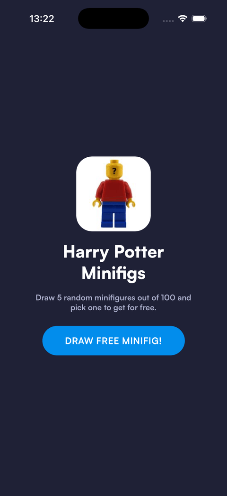
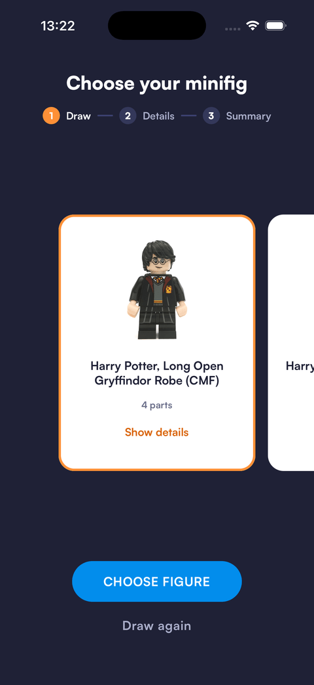
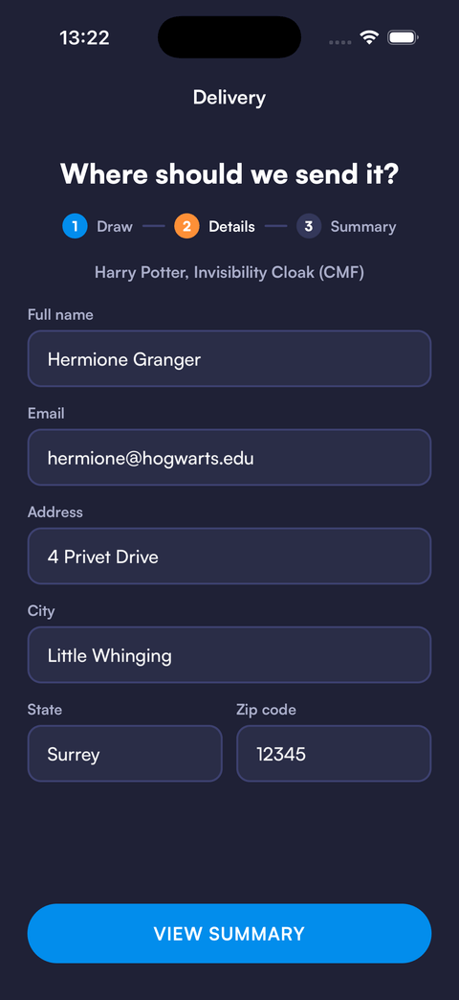
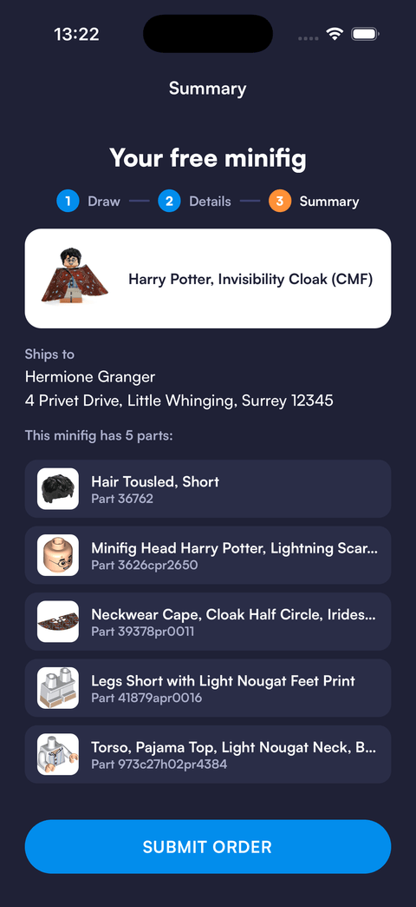

# LEGO Harry Potter Minifigs

A small React Native app: draw five random LEGO Harry Potter minifigures, pick one to get for free, fill in the delivery details and check the summary with every part of the figure. Data comes from the [Rebrickable API](https://rebrickable.com/api/).

<p>
  
  
  
  
</p>

## Features

- Random draw of five different minifigs, a horizontal carousel with snapping and a selected state
- "Show details" opens the figure's Rebrickable page in a modal browser
- Delivery form with validation (React Hook Form), focus moving from field to field and keyboard handling
- Summary with the chosen figure, the address and the list of its parts; the order itself is simulated, there is no backend
- Loading and error states with a retry, and a clear message when the API key is missing

## Setup

You need Node.js 22.13 or newer and [Expo Go](https://expo.dev/go) (SDK 58) on a phone or simulator.

1. Clone the repository: `git clone https://github.com/L3VU5/lego-harry-potter-minifig.git`
2. Install dependencies: `npm install`
3. Get a free API key in your Rebrickable account (Settings → API) and put it in a local `.env` file:

   ```sh
   cp .env.example .env
   # then set EXPO_PUBLIC_REBRICKABLE_KEY=<your key>
   ```

4. Start the app: `npm start` and press `i` (iOS simulator), `a` (Android emulator) or scan the QR code with Expo Go

`EXPO_PUBLIC_*` variables are inlined into the app bundle, so the key is visible to anyone who has the app. Rebrickable keys are free and read-only, which is fine for a demo; never put a private key there.

## Scripts

- `npm start` - Expo dev server
- `npm run typecheck` - TypeScript
- `npm test` - Jest, jest-expo and React Native Testing Library

## Project structure

```
App.tsx                     fonts, splash screen, providers
src/api/rebrickable.ts      fetch helpers and TanStack Query hooks
src/screens/                Minifigs (draw), OrderDetails, OrderSummary, Browser, navigator
src/components/             Button, TextField, StepIndicator, ErrorState, KeyboardScreen
src/theme.ts                colors and fonts
__tests__/                  API, screens and helpers
```

## Technologies Used

- React Native 0.88, React 19, Expo SDK 58
- TypeScript
- React Navigation (native stack)
- TanStack Query
- React Hook Form
- styled-components
- Jest, jest-expo, React Native Testing Library

## Contact

- Email: paweljedrasik94@gmail.com
- LinkedIn: https://www.linkedin.com/in/paweljedrasik/
- GitHub: https://github.com/L3VU5
